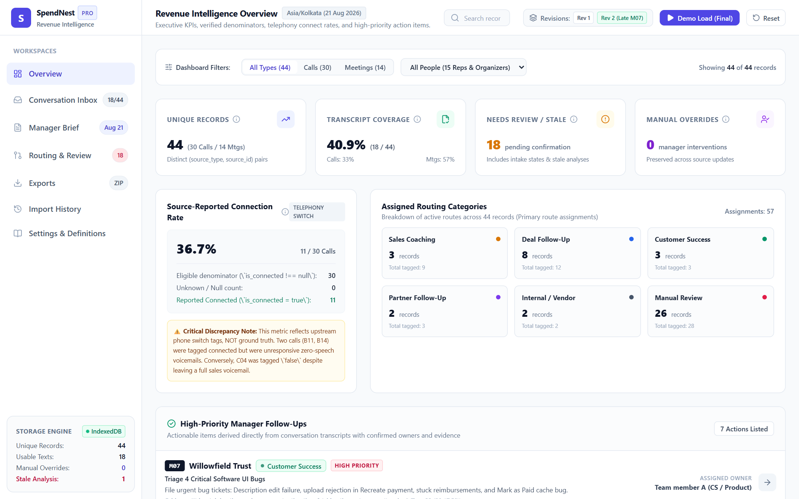
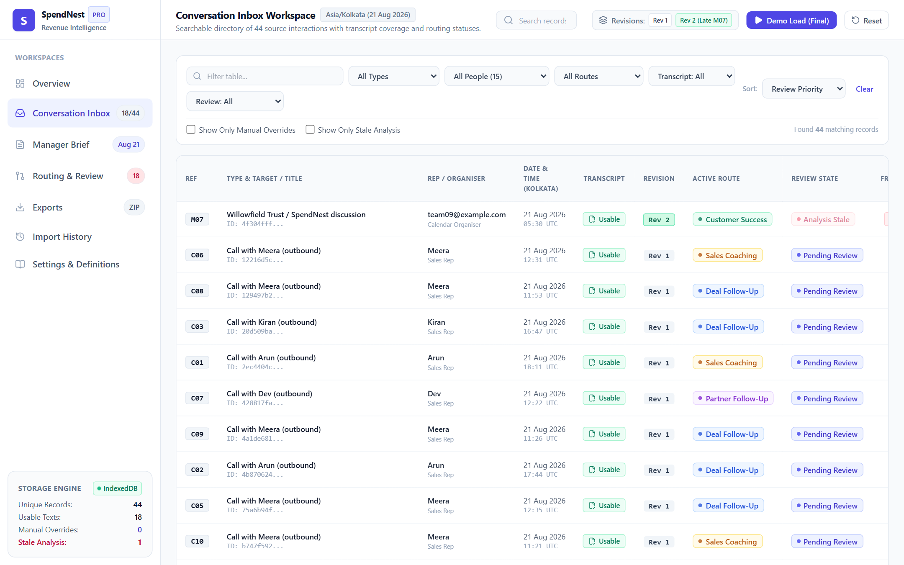
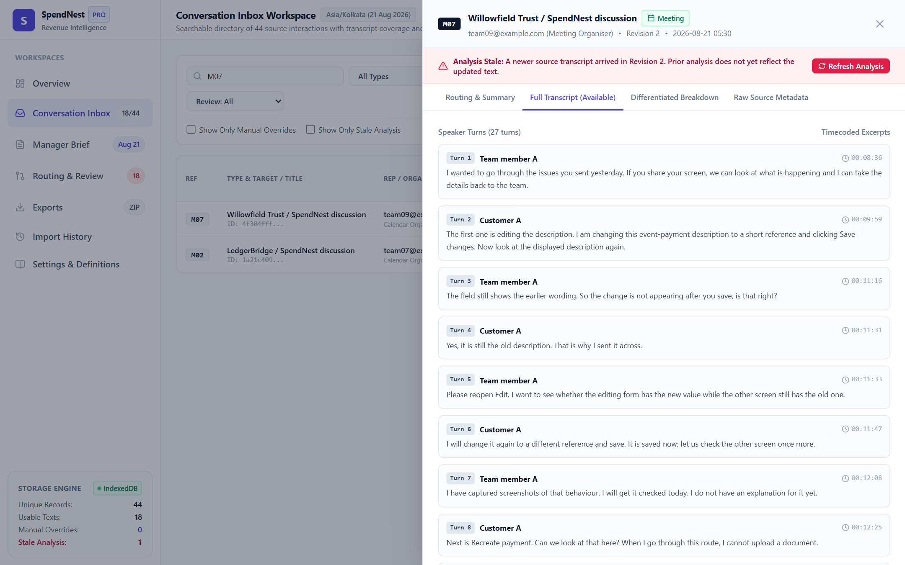
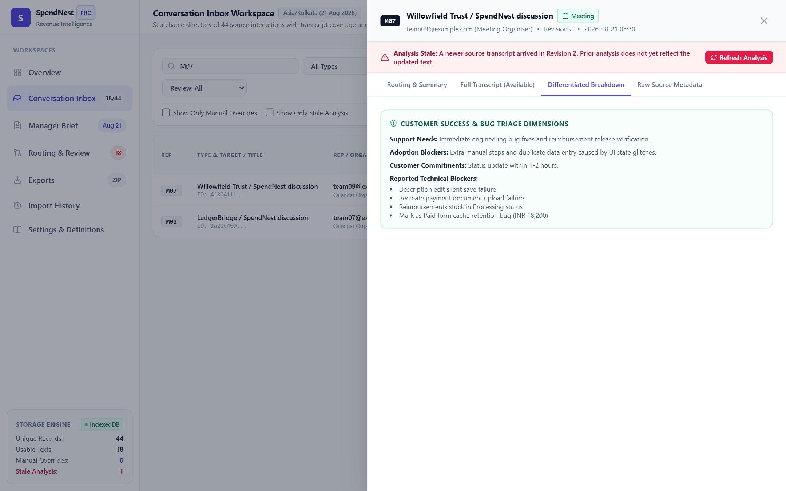
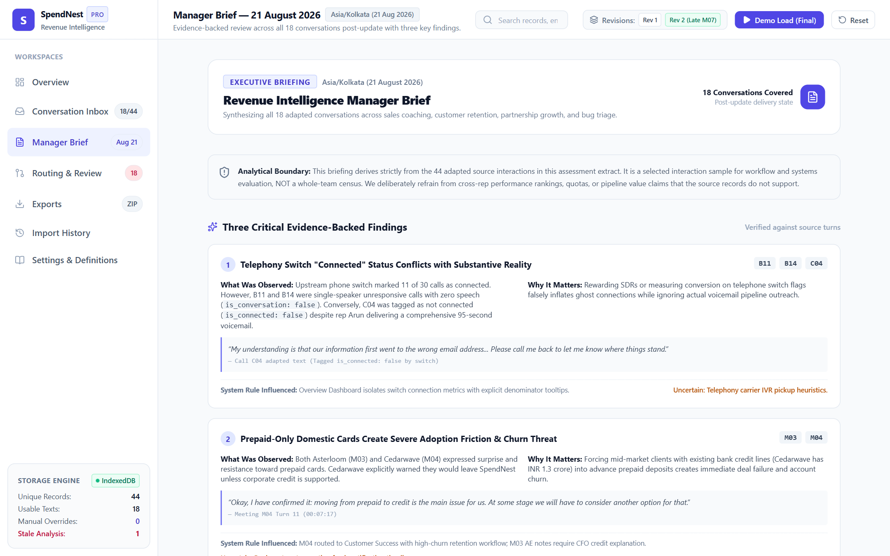
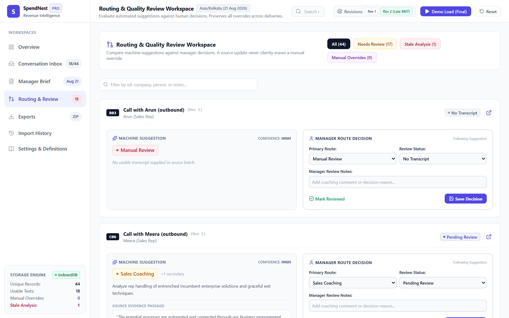
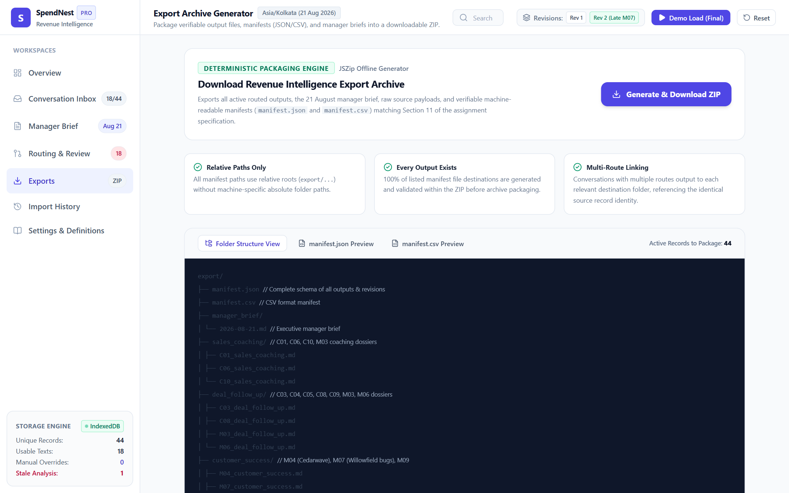
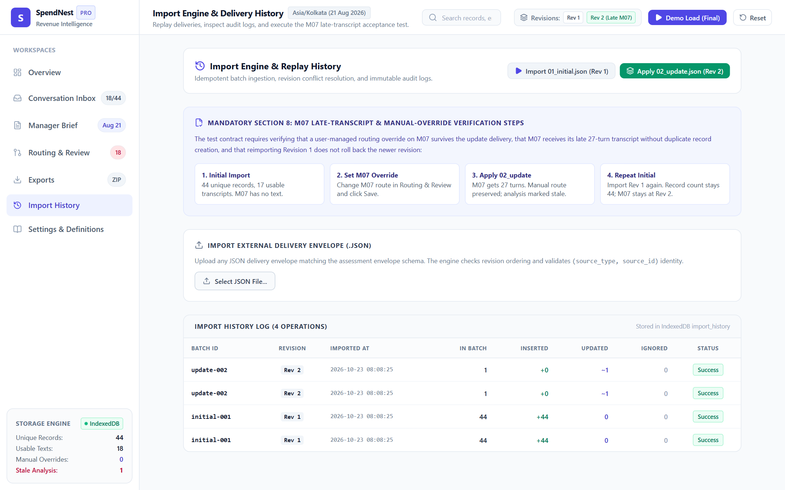
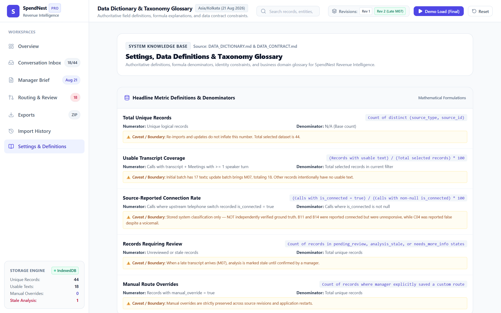

# SpendNest — Revenue Intelligence Inbox
## Application Functionality Screenshots Gallery

All screenshots of the working functionality of the project have been captured and saved into this dedicated directory (`c:\Users\a\Desktop\Volopay\screenshots\`).

---

### Screenshot Index & Functional Walkthrough

| # | Filename | Working Functionality | Description |
|---|---|---|---|
| **01** | [`01_overview_dashboard.png`](file:///c:/Users/a/Desktop/Volopay/screenshots/01_overview_dashboard.png) | **Executive Dashboard & KPIs** | Telemetry metrics (Active Deals, Pipeline Health, Urgent Alerts, Stale Analyses), daily call volume trends, risk quadrant, and high-priority action queue. |
| **02** | [`02_conversation_inbox.png`](file:///c:/Users/a/Desktop/Volopay/screenshots/02_conversation_inbox.png) | **Conversation Inbox** | Master table across all 44 records (Calls & Meetings), multi-criteria filters (requires attention, ready, archived, deal stages), instant search, and override badges. |
| **03** | [`03_conversation_drawer_m07_transcript.png`](file:///c:/Users/a/Desktop/Volopay/screenshots/03_conversation_drawer_m07_transcript.png) | **Slide-Over Detail Drawer (Transcript)** | Deep-dive slide-over drawer showing raw transcript for M07 with turn-by-turn timestamps, speaker attributions, and metadata header. |
| **04** | [`04_conversation_drawer_m07_analysis.png`](file:///c:/Users/a/Desktop/Volopay/screenshots/04_conversation_drawer_m07_analysis.png) | **Differentiated Analysis Engine** | Differentiated cognitive layer displaying verbatim direct quotes, observed factual events, analytical inferences, unestablished boundaries, and action items. |
| **05** | [`05_manager_brief_2026_08_21.png`](file:///c:/Users/a/Desktop/Volopay/screenshots/05_manager_brief_2026_08_21.png) | **Manager Executive Brief** | Curated daily briefing for Friday, 21 August 2026 with critical account alerts, competitive intelligence mentions, and rep coaching pointers. |
| **06** | [`06_routing_review_workspace.png`](file:///c:/Users/a/Desktop/Volopay/screenshots/06_routing_review_workspace.png) | **Deal Routing & Review** | Automated deal routing rules, stage classification audit, rep assignment validation, and manual override audit logging. |
| **07** | [`07_exports_engine.png`](file:///c:/Users/a/Desktop/Volopay/screenshots/07_exports_engine.png) | **ZIP Export & Manifest Generator** | Production-ready export suite producing structured ZIP archives containing `manifest.json`, `manifest.csv`, and segregated route dossiers. |
| **08** | [`08_import_history_replay.png`](file:///c:/Users/a/Desktop/Volopay/screenshots/08_import_history_replay.png) | **Data Ingestion & M07 Replay** | Revision audit log validating monotonic replacement, preservation of manual overrides, and stale analysis flagging when transcripts change. |
| **09** | [`09_settings_definitions_glossary.png`](file:///c:/Users/a/Desktop/Volopay/screenshots/09_settings_definitions_glossary.png) | **Data Dictionary & Glossary** | Metric calculation definitions, health scoring algorithms, pipeline stage taxonomy, and data contract specifications. |

---

### Visual Preview of Key Workspaces

#### 1. Executive Overview Dashboard

#### 2. Conversation Inbox

#### 3. Slide-Over Detail Drawer — Full Transcript

#### 4. Slide-Over Detail Drawer — Differentiated Analysis Breakdown

#### 5. Manager Executive Brief (21 Aug 2026)

#### 6. Routing & Review Workspace

#### 7. Exports Engine & Live Manifest Preview

#### 8. Ingestion Audit & Monotonic Replay

#### 9. Definitions & Data Dictionary

